# Saa9vi Plugin-by-Plugin Architecture Diagram Review

## Scope and review method

The uploaded `all_plugins_complete_code(20261021-055316).txt` is a concatenated TypeScript/React source snapshot with ten plugin sections. It contains **no embedded diagrams, Mermaid blocks, or flowchart definitions**. Therefore, this document does not claim to review pre-existing diagrams. Instead, it provides a proposed high-level diagram for each section based on the code visible in the upload, followed by a review of what the diagram must make clear and what still needs verification.

These are **logical architecture diagrams**, not line-by-line call graphs. Dashed/async paths indicate event or queued work. A diagram is not runtime proof: the associated tests and deployed configuration still determine whether a path works end to end.

## Overall Saa9vi integration map

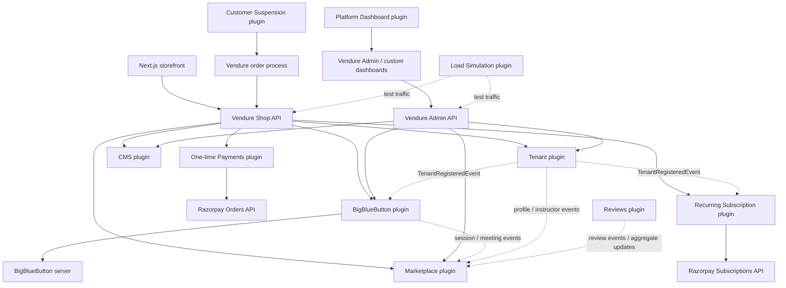

**Review:** this overview usefully distinguishes the Vendure APIs, external providers, and asynchronous cross-plugin events. Keep two payment lanes separate: one-time checkout payments and recurring subscriptions have different inbox entities, handlers, and lifecycle state. The Load Simulation plugin is a test harness, not part of the normal customer request path. The Platform Dashboard plugin is primarily a UI extension, not an independent business API.

---

## 1. `bigbluebutton-plugin` — meeting lifecycle, access, capacity and usage

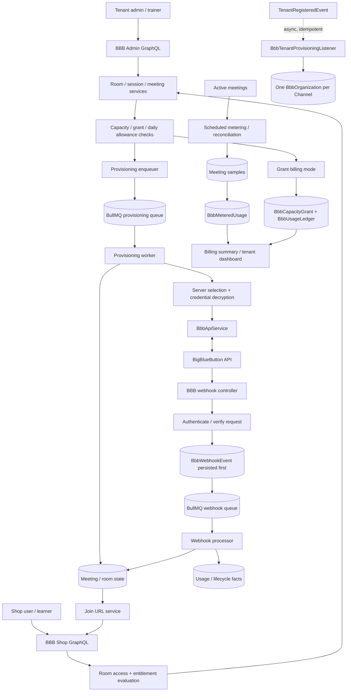

**Review notes**

- The diagram should show three distinct paths: (1) meeting provisioning, (2) inbound webhook processing, and (3) usage/billing. Combining these into one linear flow would hide important failure and retry boundaries.
- Keep `BbbWebhookEvent` persistence visibly **before** queue processing. Do not draw the webhook controller as directly mutating meeting/order state.
- Grant billing and metered billing are alternative modes. The diagram should not imply that the same meeting is charged by both paths. The code comments identify `BbbMeteredUsage` as the billing truth for metered organizations, while grants/ledger serve the grant path.
- Label `BbbEnrollment` as legacy/compatibility where it appears. Do not represent it as the sole canonical access authority; `BbbEntitlement` and the shared room-access evaluation need to be visible.
- Show the role distinction: administrators/trainers can start classes; learners join an already-active class. The `waiting_for_trainer` result is an authorized wait state, not a provisioning failure.
- Keep secrets behind `BbbEncryptionService`; never put API secrets, moderator passwords, signed URLs or webhook secrets in the diagram.
- `EventLog` remains registered in the uploaded plugin configuration. Before depicting it as an active tracing pipeline, verify current writers/consumers; the source does not itself prove whether the table is still operationally used.

**Verdict:** the architecture is substantial and reasonably separated into services, queues and policy modules. Use multiple focused sub-diagrams in developer documentation rather than one giant diagram.

---

## 2. `cms` — channel-aware content management

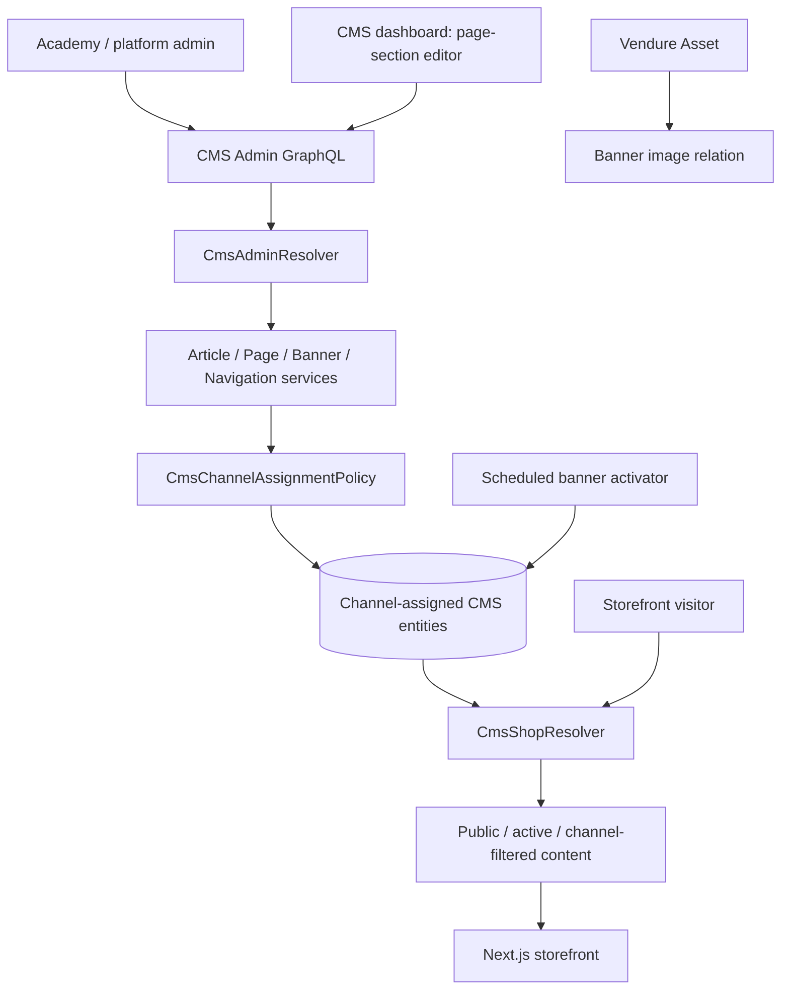

**Review notes**

- Distinguish write operations (Admin API) from public reads (Shop API). The Shop API should not be drawn as an alternate content-write route.
- Show channel assignment as a policy boundary. CMS pages, articles, and tenant-scoped banners should not be implied to be globally visible by default.
- The banner scheduler changes activation based on time; it does not replace request-time visibility checks.
- Reuse Vendure `Asset` for uploaded images rather than depicting CMS as a separate file-storage system.
- The section editor supports typed layout blocks such as hero, rich text, product grid, article grid, and banner slot. If a more detailed editor diagram is needed, show the server-side section union and storefront renderer as a matching contract.

**Verdict:** a simple two-lane Admin-write / Shop-read diagram is appropriate. The critical details are channel scope, publication/activation rules, and Asset references.

---

## 3. `customer-suspension` — platform-wide and channel-scoped checkout controls

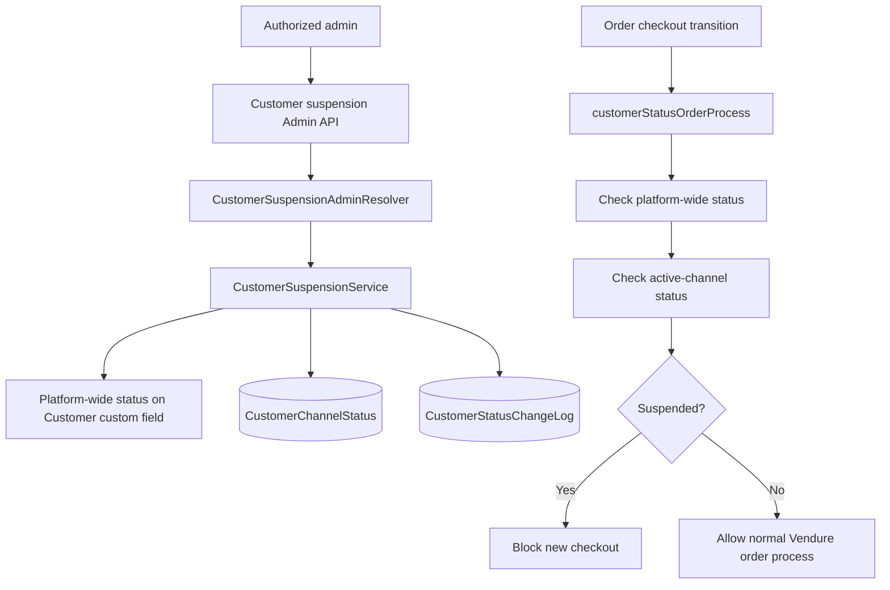

**Review notes**

- Do not represent suspension as deleting a customer or automatically revoking all existing course access. The source describes it as blocking **new checkouts**; existing entitlements continue until their normal expiry/revocation rules.
- Distinguish the global status stored on `Customer.customFields.status` from per-channel `CustomerChannelStatus`. These are independent status axes and should both be shown.
- Include the change log in the diagram: suspension state and the audit of the state change are separate records.
- The platform-wide mutation and channel-scoped mutation have different permission expectations; show those roles separately in a more detailed authorization diagram.

**Verdict:** the key design concept is the two-level check at the order-process boundary. A diagram that only shows an Admin toggle would miss the actual enforcement point.

---

## 4. `load-simulation-plugin` — controlled test traffic and diagnostics

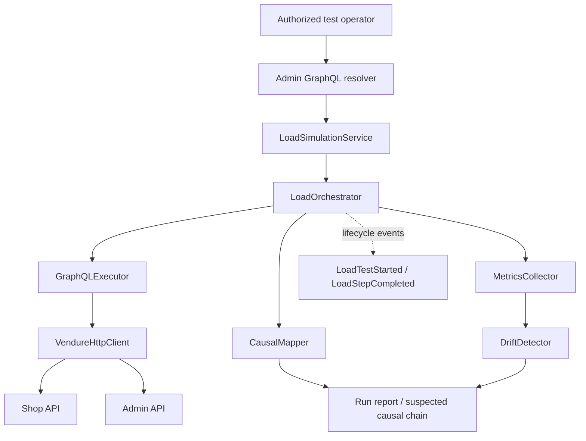

**Review notes**

- Place this in a clearly separate “test/diagnostics” area. It should not be drawn as a required runtime dependency for any production request.
- The HTTP client can use API tokens. Verify the resolver permission gate, environment allow-list, request limits, and production-disabled-by-default behavior before deploying it anywhere reachable by untrusted users.
- Separate observed metrics from causal hypotheses. `CausalMapper` and `DriftDetector` support analysis but should not be drawn as definitive proof that one subsystem caused a failure.
- Label external traffic as configurable test traffic and make target URLs explicit; localhost defaults are not a deployment contract.

**Verdict:** the architecture is understandable as an orchestration harness. The diagram should emphasize containment, authorization and target-environment safeguards.

---

## 5. `marketplace` — search projection, attribution, commissions and ads

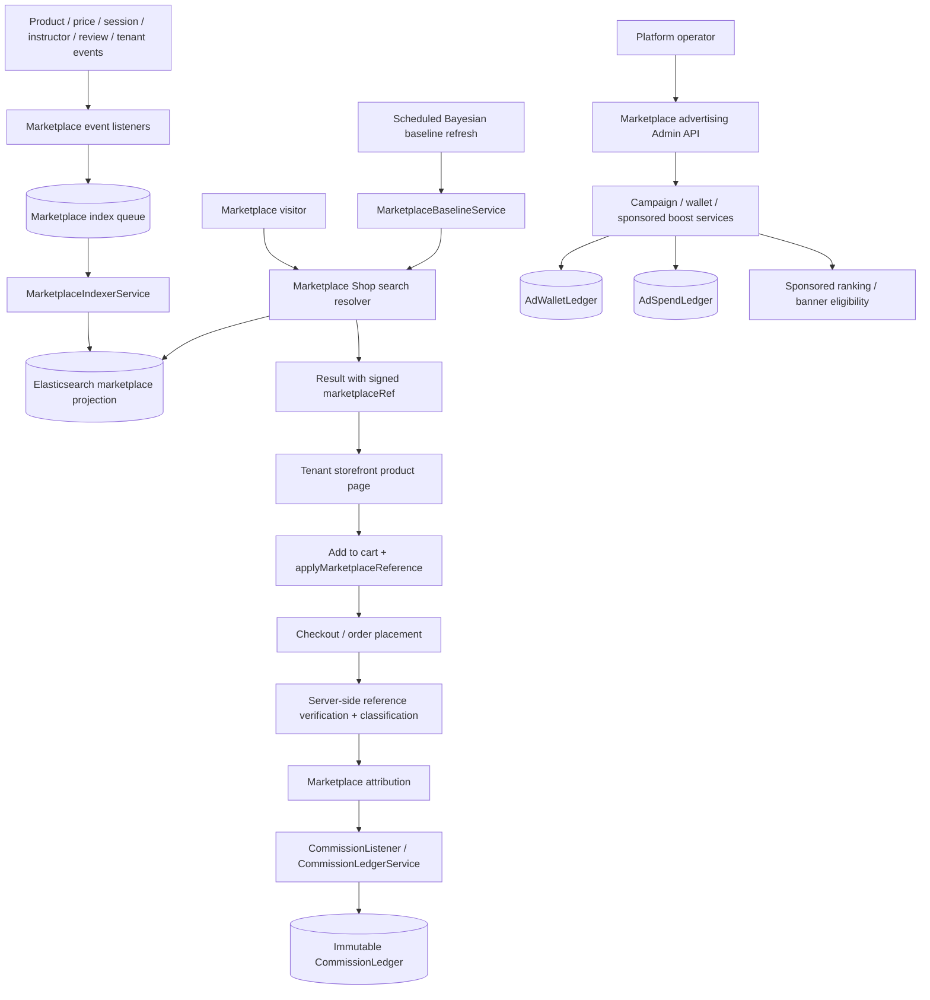

**Review notes**

- Keep Elasticsearch as a **read projection**, not the system of record for products, sessions, reviews, or tenant identity. Events and supported reindex paths must converge the projection.
- The `marketplaceRef` is an opaque signed reference, not a trusted `orderSource` supplied by the browser. Classification and reference validation belong on the backend; order source and reference custom fields are configured read-only for ordinary GraphQL clients.
- Draw the order/commission path as downstream of a verified order/attribution decision. Do not imply that clicking a marketplace listing immediately earns a commission.
- Keep ad wallet, ad-spend, and commission ledgers distinct. They record different financial facts and should not be collapsed into a generic “marketplace ledger”.
- Verify the event-to-index mapping and full reindex process before treating the search projection as converged. The supplied snapshot references indexer/listener classes from the plugin configuration but does not include every core implementation file in the marketplace section, so this diagram is a high-level contract rather than a verified call graph.

**Verdict:** use two diagrams in final project docs if possible: “Search/index projection” and “Attribution/commission/advertising”. The combined diagram above is an overview only.

---

## 6. `payments` — one-time Razorpay checkout

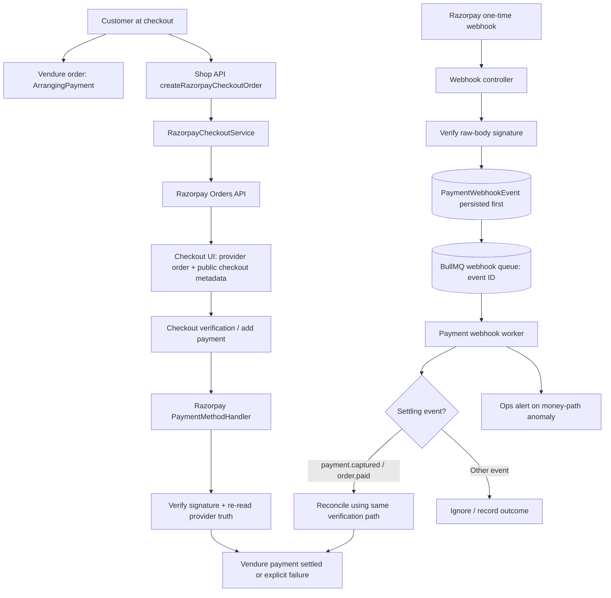

**Review notes**

- This plugin is for **one-time commerce checkout**. Keep it separate from recurring subscriptions and their `ProviderWebhookEvent` inbox.
- The webhook path is a reconciliation safety net, not a shortcut around signature verification or provider truth. The source describes an immutable inbox, an event-ID queue, duplicate handling, and the same verification/settlement path.
- Only documented settling event types should lead to payment settlement; `payment.failed` and unrelated events must not be drawn as successful settlement transitions.
- Make the order-state guard explicit: checkout verification should be bound to the authenticated customer's own order and the correct channel.
- Do not place `RAZORPAY_KEY_SECRET` in Dashboard configuration or GraphQL input; the handler intentionally uses environment credentials.
- Runtime tests and a live/test Razorpay account are still required to prove provider behavior. Source presence is not equivalent to end-to-end verification.

**Verdict:** clear separation of synchronous checkout verification and asynchronous webhook reconciliation. The diagram should highlight shared verification logic, not two independent settlement implementations.

---

## 7. `platform-dashboard` — dashboard presentation extension

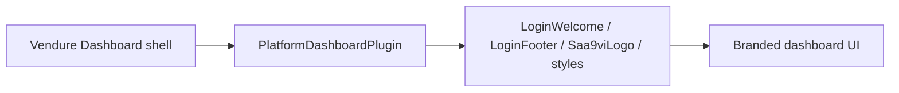

**Review notes**

- Keep this diagram deliberately small. The uploaded plugin registers a Dashboard extension and options provider; it does not define an independent domain model, GraphQL API, or business-processing service.
- Do not place platform authorization, tenant isolation or marketplace operations inside this plugin unless there is separate code proving that behavior. Those belong to the relevant backend services and permissions.
- Treat the UI customization as presentation, not a security boundary.

**Verdict:** a small component diagram is enough. Adding infrastructure or business-flow boxes would overstate this plugin's responsibility.

---

## 8. `reviews` — review lifecycle, moderation, verification and aggregation

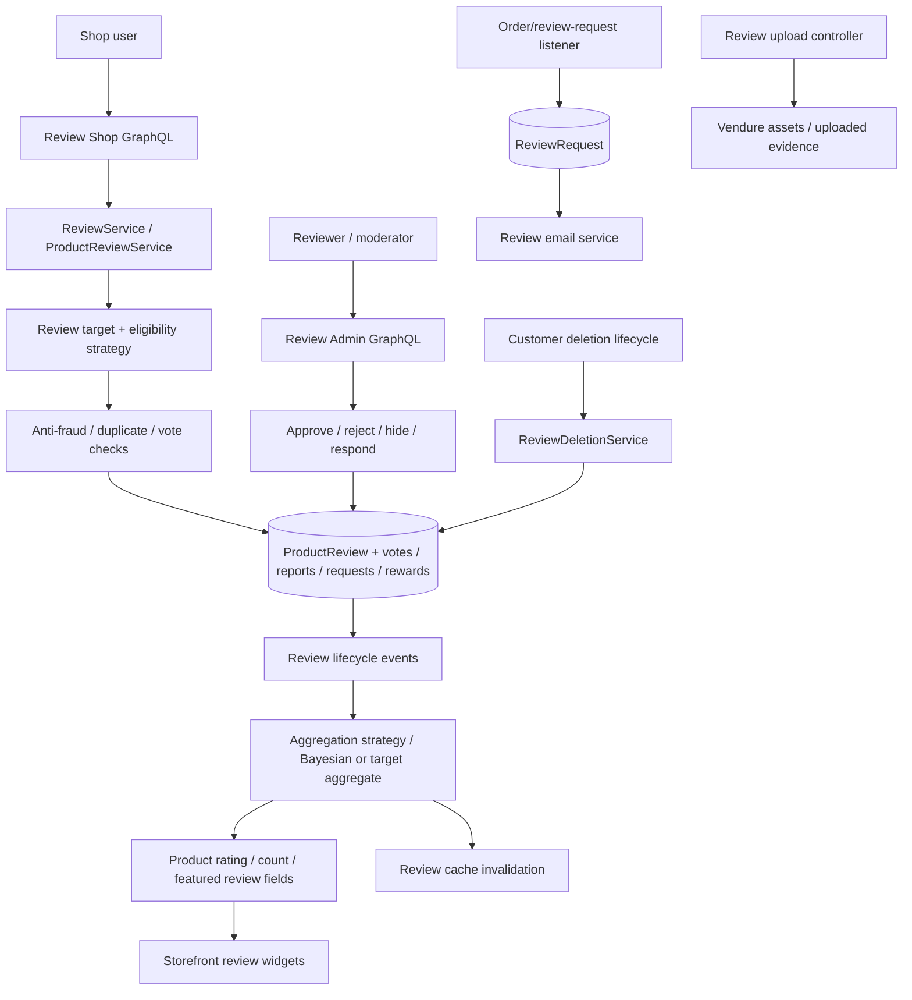

**Review notes**

- Make the review status lifecycle visible (e.g., submitted, moderated, approved/hidden/rejected) if the detailed diagram is intended for developers. Aggregation should consume only states that the configured strategy considers eligible.
- Distinguish target/eligibility/aggregation strategy registries from the concrete product-review strategy. The plugin is designed as an abstraction, but the uploaded snapshot proves a product target implementation specifically; do not imply that every advertised target type is fully implemented without checking its provider and tests.
- Customer deletion is a separate lifecycle hook that removes/anonymizes relevant review associations; do not show a review's deletion as an automatic consequence of suspension.
- Show uploads separately from review metadata. The upload controller and upload validation are an additional boundary, not just another GraphQL field.
- Product custom fields expose derived rating/count/featured-review data; avoid drawing raw review rows as a direct storefront query without moderation/visibility rules.

**Verdict:** a lifecycle diagram is more useful than a simple CRUD diagram. The major review risks are moderation state, eligibility, anti-fraud, aggregation consistency and deletion semantics.

---

## 9. `subscription` — recurring billing and subscription entitlements

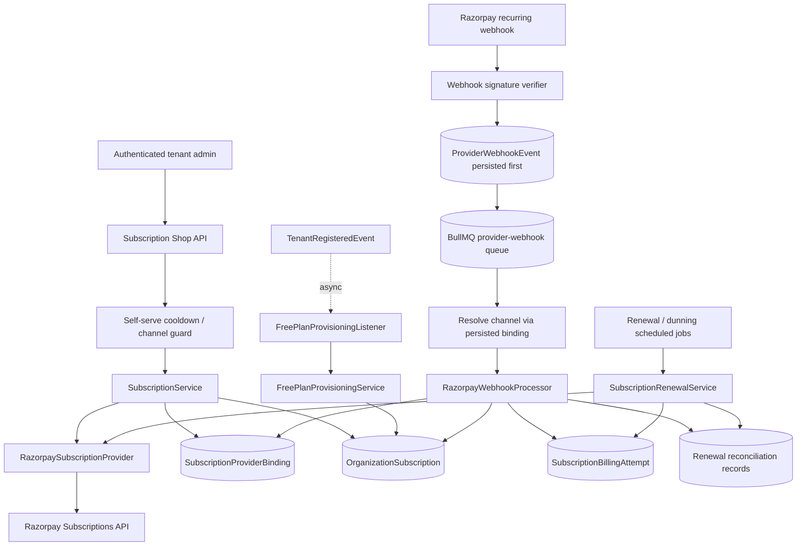

**Review notes**

- Keep provider-free Free Basic activation separate from paid/provider-wired subscriptions: the Free Basic path creates local active state without a fake provider binding; paid plans require an actual provider subscription and binding.
- Channel resolution for recurring webhooks must be based on the persisted provider binding, not a client-controlled or untrusted channel hint in the payload.
- Show that `ProviderWebhookEvent` is persisted before enqueuing and that the queue passes an inbox ID, not the whole webhook as authoritative working state.
- `SubscriptionBillingAttempt` and reconciliation-required records matter for recovery and financial auditing. Avoid drawing a renewal as one atomic operation across Razorpay and the local database; the provider API call and local persistence do not share a distributed transaction.
- This is a different lane from the one-time `PaymentWebhookEvent` handler. Do not combine the two inboxes.
- Tenant self-serve redirects are not proof of activation; the webhook-driven subscription state remains authoritative.

**Verdict:** model the recurring billing lifecycle as a stateful asynchronous process with provider binding, inbox, queue, processor, and reconciliation. Avoid a simplistic “pay → active” line.

---

## 10. `tenant-plugin` — tenant registration, profiles, hostname mapping and presentation

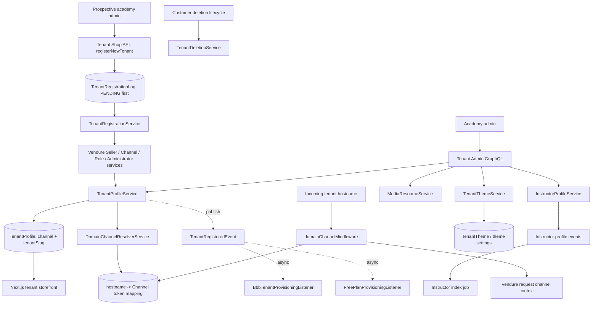

**Review notes**

- Channel is the tenant boundary. Use `Channel`/`ctx.channelId` as the identity source; `TenantProfile` is associated metadata and `tenantSlug` is the hostname slug. Do not recreate a separate tenant ID as an alternative isolation key.
- Registration is not one distributed atomic transaction across Vendure, Redis and async consumers. The diagram must show persistence and Redis mapping separately, plus asynchronous eventual consistency for BBB organization and Free Basic provisioning.
- `TenantRegistrationLog` is persisted before the orchestration in the supplied code; it is an audit/recovery record, not the authoritative tenant profile.
- Redis stores a derived hostname-to-channel-token mapping. Do not make Redis the master owner of tenant identity, and do not add a second unrelated mapping store.
- The backend `domainChannelMiddleware` is described in the code as non-blocking on unresolved mapping and may continue with the default channel. The storefront reverse-proxy trust boundary is a separate security requirement: the proxy must overwrite the tenant header based on trusted hostname resolution. Do not imply this middleware alone proves fail-closed behavior.
- Instructor indexing and tenant theme presentation are supporting flows; they are not synchronous prerequisites for registering a tenant.

**Verdict:** draw registration, hostname resolution, and asynchronous cross-plugin provisioning as separate lanes. The biggest diagram omission to avoid is hiding the proxy as the trust boundary.

---

## Cross-section review findings

1. **No existing diagrams were present in the upload.** This file contains source code under ten plugin headings. The diagrams above are proposed interpretations of that source.
2. **Keep the two Razorpay lifecycles separate.** `payments` uses the one-time `PaymentWebhookEvent` and payment handler; `subscription` uses `ProviderWebhookEvent`, provider binding and recurring lifecycle state.
3. **Show tenant identity consistently.** The channel is the tenant boundary. Hostname mapping is a derived lookup, not a second tenancy model.
4. **Show async boundaries explicitly.** BullMQ jobs, event listeners and scheduled tasks mean the caller's response can precede eventual consistency (especially tenant registration → BBB organization / Free Basic plan).
5. **Keep ledgers semantically distinct.** BBB usage, provider billing attempts, marketplace commissions, ad wallet and ad spend capture different facts and should not be represented as a single generic ledger.
6. **Separate state from projection.** Elasticsearch, dashboard summaries and product review fields are read/derived models; draw their source events and reindex/reconciliation mechanisms.
7. **Label uncertainty.** The uploaded snapshot does not include every file for every referenced collaborator. In particular, some Marketplace indexer/listener implementations are referenced by configuration but are not present in that section of the uploaded source, so the Marketplace picture needs verification against the live checkout before being treated as a verified call graph.
8. **Do not use a diagram as test evidence.** Each security- or money-sensitive edge still needs a direct test/runtime proof. In particular: reverse-proxy header spoofing, checkout/webhook idempotency, cross-channel isolation, BBB error/retry handling and marketplace attribution validation.

## Suggested presentation standard

For final project documentation, use one overview diagram plus these ten plugin-level diagrams. Keep each diagram focused on **actors → API boundary → services/policies → persistence/queues → external systems**. Make async flows dashed, mark read projections distinctly, label trust/authorization gates, and avoid listing every entity and helper method on a single page.
